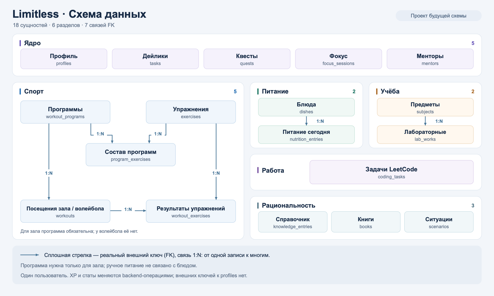

# Целевая база данных Limitless

Дата: 9 октября 2026 года.

Итоговая схема обсуждённого объёма: **18 таблиц**, один личный профиль, одна общая шкала опыта. Это описание целевой PostgreSQL БД. Оно заменяет раннюю версию этого документа с тремя сущностями ядра. Начальная миграция новой пустой БД подготовлена отдельно. Бэкенд под эту схему реализован в `server`: [запуск](../server/README.md), [все маршруты и контракты](../server/API.md). Фронтенд переводится на новые контракты отдельно.

[Установка пустой БД и дальнейшие миграции](../server/supabase/redesign/README.md). Подготовка файлов не означает их применение к Supabase.

Для выбранной замены старой БД в том же проекте подготовлен [единый SQL-файл очистки и создания](../server/supabase/redesign/replace-legacy.sql). Он удаляет прежние данные Limitless и создаёт эту схему без наполнения; запускается пользователем в SQL Editor.

Пользователь самостоятельно разрабатывает фронтенд. Эта схема задаёт данные и правила для последовательной реализации бэкенда. Все разделы не обязательно реализовывать одновременно.

[Диаграмма PNG](assets/backend-schema.png) · [Диаграмма SVG](assets/backend-schema.svg) · [Исходник Mermaid](assets/backend-schema.mmd)

## Как читать схему

- Имена таблиц и полей приведены на английском, объяснения — на русском.
- В таблицах ниже `NULL: да` означает необязательное значение; остальные поля обязательны.
- `PK` — первичный ключ, `FK` — внешний ключ, `UNIQUE` — уникальность значения или сочетания значений.
- `uuid` — идентификатор записи; `text` — строка; `boolean` — логическое значение; `integer` / `smallint` / `bigint` — целые числа.
- `numeric(14,2)` — точное десятичное число с двумя знаками после запятой. Общий XP и награды хранятся так, а не в `float`.
- `numeric(10,2)` используется для КБЖУ, `numeric(8,2)` — для рабочих весов, `numeric(8,3)` — для количества порций.
- `date` — календарный игровой день в Москве. `timestamptz` — момент времени; границы дня рассчитываются в `Europe/Moscow`, а не по часовому поясу сервера.
- Значения вроде `easy`, `gym`, `positive` хранятся как `text` с ограничением `CHECK`. Отдельные таблицы и PostgreSQL ENUM для этих небольших наборов не нужны.
- `jsonb` используется для компактных структур, принадлежащих одной записи: реплик, изображений, периодов отсутствия, снимков наград. Формат каждого JSON указан ниже и должен валидироваться бэкендом.
- Ссылки между самостоятельными сущностями представлены внешними ключами, а не массивами произвольных ID внутри JSON.

**Общие поля всех 18 таблиц** дополняют каждую таблицу полей ниже:

| Поле | Тип PostgreSQL | NULL | Описание |
|---|---|---|---|
| `created_at` | `timestamptz` | нет | Время создания; по умолчанию `now()` |
| `updated_at` | `timestamptz` | нет | Время последнего изменения; обновляется триггером БД при записи бэкендом |
| `version` | `bigint` | нет | Версия записи: триггер устанавливает `0` при вставке и увеличивает на один при обновлении; используется бэкендом для проверки устаревших команд |

Версия дополняет транзакции, а не заменяет их. Например, команда отмены из старой вкладки не должна отменить более позднее повторное выполнение.

Таблицы, где сохраняется пользовательское действие, принимают стабильный ID запроса/записи. Повтор сохранения с тем же ID не создаёт вторую запись и вторую награду.

## Границы принятого решения

**Продуктовые правила** в разделах ниже основаны на обсуждении: один пользователь, общий XP, ручные отметки, отсутствие ненужных историй, короткие сценарии использования.

**Техническая основа этой схемы:** PostgreSQL-типы, внешние ключи, снимки начислений, версии записей, агрегированные счётчики квестов, единая обработка дня. Это выбранные решения для реализации, а не уже применённые миграции.

**Рабочие допущения**, которые не выдаются за отдельно согласованные пользователем правила:

- Сохранённый фокус целиком относится ко дню нажатия «Сохранить».
- Сила и остальные характеристики имеют нижнюю границу `0`; верхняя граница пока не вводится. Пороги этапов задаются балансом.
- Для лабораторной отметка «сдана» требует отметки «сделана».
- Нормы питания фиксируются на игровой день; изменение настроек действует со следующего дня. До первичной настройки норм питание не меняет XP.
- Расписание спорта пока общее для тренировочных дней. Программы зала к дням недели не привязываются.
- Для нового квеста учитывается максимальный ранее достигнутый ранг: однажды открытая сложность остаётся доступной.
- Исправление исходного действия после завершения зависимого квеста требует отдельного правила отката; соответствующая операция временно отклоняется, а не молча создаёт противоречивые данные. Подробности — в разделе об отмене.

**Отложено:** точные числа баланса, пет-проекты, ИИ, формула радара мышечных групп, новые баффы/дебаффы, центр уведомлений. Таблица `daily_stats` не согласована и в эту схему не входит.

## Список сущностей

| Раздел | Таблица | Назначение |
|---|---|---|
| Ядро | [profiles](#profiles) | Единственный профиль, показатели, настройки и служебное состояние дня |
| Ядро | [tasks](#tasks) | Пул дейликов и их текущие назначения |
| Ядро | [quests](#quests) | Квесты, доступность, прогресс и завершение |
| Ядро | [focus_sessions](#focus_sessions) | Сохранённые фокус-сессии и начисленный опыт |
| Менторы | [mentors](#mentors) | Персонажи, изображения и готовые реплики |
| Спорт | [workout_programs](#workout_programs) | Готовые программы зала |
| Спорт | [exercises](#exercises) | Справочник упражнений |
| Спорт | [program_exercises](#program_exercises) | Упражнения программы и порядок отображения |
| Спорт | [workouts](#workouts) | Посещения зала и отметки волейбола |
| Спорт | [workout_exercises](#workout_exercises) | Один результат упражнения за посещение |
| Питание | [dishes](#dishes) | Готовые блюда с КБЖУ одной порции |
| Питание | [nutrition_entries](#nutrition_entries) | Блюда и ручные записи текущего дня |
| Учёба | [subjects](#subjects) | Учебные предметы |
| Учёба | [lab_works](#lab_works) | Лабораторные с отметками выполнения и сдачи |
| Работа | [coding_tasks](#coding_tasks) | Пул ссылок LeetCode и текущая выдача |
| Рациональность | [knowledge_entries](#knowledge_entries) | Законы, методы и принципы |
| Рациональность | [books](#books) | Книги и текущий прогресс чтения |
| Рациональность | [scenarios](#scenarios) | Ситуации, эталонные ответы и текущая попытка |

Количество таблиц не означает столько же экранов. Две таблицы спорта служат связями: состав программы и результат упражнения в посещении.

## profiles

Единственная строка с `id = 1`. Других пользователей, регистрации и `user_id` в предметных таблицах нет. Защита доступа к личному приложению нужна независимо от количества пользователей; способ зависит от места размещения и выбирается при реализации.

| Поле | Тип PostgreSQL | NULL | Описание |
|---|---|---|---|
| `id` | `smallint`, PK | нет | Значение всегда `1`; `CHECK (id = 1)` исключает второй профиль |
| `name` | `text` | нет | Имя |
| `avatar_url` | `text` | да | Ссылка или путь к аватару |
| `title` | `text` | да | Подпись или титул |
| `timezone` | `text` | нет | `Europe/Moscow`; в текущей версии другой пояс не используется |
| `training_days` | `smallint[]` | нет | Общие тренировочные дни, числа `1–7` без повторов; пустой массив допустим |
| `study_days` | `smallint[]` | нет | Учебные дни, числа `1–7` без повторов |
| `study_breaks` | `jsonb` | нет | Каникулы; массив периодов, по умолчанию `[]` |
| `planned_absences` | `jsonb` | нет | Заранее заданное отсутствие; массив периодов, по умолчанию `[]` |
| `total_exp` | `numeric(14,2)` | нет | Единственный общий опыт, по умолчанию `0`, минимум `0` |
| `highest_rank` | `text` | нет | Максимальный достигнутый ранг для сохранения доступа к квестам; начальное значение `E` |
| `stat_intelligence` | `integer` | нет | Интеллект, по умолчанию `0` |
| `stat_strength` | `integer` | нет | Сила, по умолчанию `0` |
| `stat_rationality` | `integer` | нет | Рациональность, по умолчанию `0` |
| `stat_ego` | `integer` | нет | Эго, по умолчанию `0` |
| `stat_discipline` | `integer` | нет | Дисциплина, по умолчанию `0` |
| `stat_energy` | `integer` | нет | Энергия, по умолчанию `0` |
| `login_streak` | `integer` | нет | Серия дней входа; по умолчанию `0` |
| `activity_streak` | `integer` | нет | Серия дней активности; по умолчанию `0` |
| `last_login_date` | `date` | да | Последний день засчитанного входа и его единственной награды |
| `last_activity_date` | `date` | да | Последний день засчитанной активности |
| `day_activity_snapshot` | `jsonb` | да | Серия и последняя дата активности на начало открытого дня; нужны для отмены единственной активности сегодня |
| `current_day` | `date` | да | Игровой день, состояние которого сейчас открыто; маркер вместо раннего `daily_set_date` |
| `last_closed_day` | `date` | да | Последний полностью обработанный день; защищает от повторных штрафов и расчёта питания |
| `daily_set_completed_at` | `timestamptz` | да | Когда все пять текущих дейликов стали выполнены; защищает счётчик полных наборов от повторного увеличения |
| `quest_counters` | `jsonb` | нет | Накопительные факты для квестов, которые нельзя восстановить после очистки текущих выдач; по умолчанию `{}` |
| `nutrition_goal_calories` | `numeric(10,2)` | да | Целевая калорийность дня; значение задаётся пользователем |
| `nutrition_goal_protein` | `numeric(10,2)` | да | Целевой белок, г |
| `nutrition_goal_fat` | `numeric(10,2)` | да | Целевые жиры, г |
| `nutrition_goal_carbs` | `numeric(10,2)` | да | Целевые углеводы, г |
| `day_nutrition_goals` | `jsonb` | да | Снимок четырёх норм на `current_day`; `NULL`, пока нормы не настроены |
| `day_balance_version` | `text` | да | Версия неизменяемых правил баланса для текущего дня; определения версий хранятся в коде бэкенда |
| `last_mentor_popup_at` | `timestamptz` | да | Последний фактический показ модалки с ментором |
| `pending_rank_change` | `jsonb` | да | Одно ещё не показанное изменение ранга; после подтверждения показа очищается |

Текущий `rank`, уровень, опыт внутри уровня и порог следующего уровня **вычисляются из `total_exp` и баланса**, а не изменяются независимо. API возвращает готовые значения для фронта. `highest_rank` — историческая граница доступа, она не является текущим рангом.

`day_activity_snapshot` имеет форму `{ "streak": 5, "lastActiveDate": "2026-10-08" }`: `streak` — неотрицательное целое, `lastActiveDate` — дата либо `null`. При исправлениях сегодняшняя активность повторно проверяется по дейликам, завершённым квестам и сохранённому фокусу. Если оснований не осталось, восстанавливается снимок начала дня. В момент закрытия дня применяются правила разрыва/заморозки, затем создаётся снимок нового дня.

`pending_rank_change` имеет форму `{ "id": "edc198c5-fc81-470f-bcba-561e65fb3a61", "fromRank": "E", "toRank": "D", "changedAt": "2026-10-09T09:00:00Z" }`: ID — строка UUID, ранги — допустимые ключи, время — строка ISO 8601. Техническое правило: несколько непоказанных изменений объединяются от начального ранга до актуального. Если ранг вернулся к исходному, уведомление очищается. Подтверждение содержит ID уведомления, чтобы старый ответ фронта не стёр новое. Это одно текущее уведомление, не история рангов или реплик.

Порядок рангов: `E → D → C → B → A → S → S+ → SS → SSS`. XP может уменьшаться, текущий ранг — понижаться.

Шесть характеристик хранят свои значения. Этапы вроде `0–100` и `100–1000` и масштабирование радара вычисляются бэкендом. Эти числа обсуждались как направление, не как окончательная таблица порогов.

Форматы периодов:

~~~json
{
  "studyBreaks": [
    { "startDate": "2027-01-01", "endDate": "2027-01-15" }
  ],
  "plannedAbsences": [
    {
      "startDate": "2027-02-01",
      "endDate": "2027-02-07",
      "reason": "Отпуск"
    }
  ]
}
~~~

В каждой из двух колонок хранится соответствующий массив, без внешней обёртки. Даты включительны, `startDate ≤ endDate`. `reason` — необязательная строка. Новое отсутствие начинается не раньше следующего игрового дня и не отменяет уже выданные сегодняшние дейлики. Пересекающиеся интервалы нормализуются, истекшие интервалы не меняются задним числом.

Формат `day_nutrition_goals`:

~~~json
{
  "calories": 2300,
  "protein": 140,
  "fat": 75,
  "carbs": 260
}
~~~

Это пример структуры, **не рекомендация по питанию и не принятые пользователем нормы**. Все четыре цели либо заданы положительными числами, либо все ещё `NULL`.

Содержимое `quest_counters` — только фиксированные ключи и неотрицательные целые числа:

~~~json
{
  "daily_tasks_completed": 0,
  "daily_sets_completed": 0,
  "coding_tasks_solved": 0,
  "scenarios_completed": 0
}
~~~

Это общие счётчики, а не история назначений или статистика по дням. Полный реестр источников прогресса приведён далее.

Вход засчитывается при первом открытии приложения за день, без отдельной кнопки. Награда небольшая, возрастает в течение первой недели серии и затем ограничивается; числа отложены. Активность — хотя бы один выполненный дейлик, завершённый квест или сохранённая фокус-сессия. Другие новые источники XP автоматически в это определение не добавляются.

## tasks

Одна строка — задача общего пула и состояние её текущего назначения. Отдельной `daily_tasks` и архива назначений нет.

| Поле | Тип PostgreSQL | NULL | Описание |
|---|---|---|---|
| `id` | `uuid`, PK | нет | Постоянный ID задачи пула |
| `title` | `text` | нет | Название |
| `description` | `text` | нет | Описание; пустая строка допустима |
| `icon` | `text` | да | Ключ иконки |
| `category` | `text` | нет | `study / sport / health / work / rationality` |
| `completion_action` | `text` | да | Дополнительная подсказка после выполнения: `log_gym_results` для напоминания записать веса; иначе `NULL` |
| `is_enabled` | `boolean` | нет | Участвует ли задача в выдаче; по умолчанию `true` |
| `availability` | `jsonb` | нет | Ограничения доступности; по умолчанию `{}` |
| `cooldown_days` | `integer` | нет | Длительность кулдауна, ≥ `0`; задаётся для каждой задачи |
| `next_available_on` | `date` | да | Самая ранняя дата следующей выдачи |
| `reward_xp` | `numeric(14,2)` | нет | Награда XP, ≥ `0` |
| `reward_stats` | `jsonb` | нет | Прибавки характеристик; по умолчанию `{}` |
| `penalty_xp` | `numeric(14,2)` | нет | Положительный размер списания XP за пропуск, ≥ `0` |
| `penalty_stats` | `jsonb` | нет | Положительные размеры списаний характеристик; по умолчанию `{}` |
| `assignment_id` | `uuid` | да | Новый ID при каждом назначении; защищает от запросов прошлой выдачи |
| `assigned_for` | `date` | да | День текущего назначения |
| `completed_at` | `timestamptz` | да | Выполнено ли текущее назначение и когда |
| `assigned_effects` | `jsonb` | да | Снимок награды и штрафа на момент выдачи |
| `applied_reward` | `jsonb` | да | Фактически выданные XP и характеристики текущего выполнения; для отмены |

Формат `availability`:

~~~json
{
  "trainingDayOnly": false,
  "studyDayOnly": true,
  "excludeStudyBreaks": true,
  "requiredStudyAction": "lab_done"
}
~~~

Три первых ключа — `boolean` с отсутствующим значением как `false`. `requiredStudyAction` — необязательный `lab_done / lab_passed / subject_closed`. Это техническое условие для проверки, что есть подходящая незавершённая учебная работа: соответственно несделанная лабораторная, сделанная несданная лабораторная или незакрытый предмет. Оно не прикрепляет дейлик к конкретной лабораторной и не выполняет её автоматически.

Произвольных выражений в JSON нет. Бэкенд умеет только перечисленные условия.

Формат `reward_stats` и `penalty_stats`:

~~~json
{ "intelligence": 2, "discipline": 1 }
~~~

Допустимы шесть ключей характеристик, значения — неотрицательные целые. Пропущенный ключ означает `0`.

Формат `assigned_effects`:

~~~json
{
  "reward": {
    "xp": 20,
    "stats": { "intelligence": 2 }
  },
  "penalty": {
    "xp": 10,
    "stats": { "discipline": 1 }
  }
}
~~~

Числа в примерах иллюстративны. `applied_reward` имеет форму `{ "xp": 20, "stats": { "intelligence": 2 } }`, но содержит фактически применённые прибавки. Изменение шаблона задачи не меняет условия сегодняшнего назначения.

Правила:

- Пул содержит более 50 задач; достаточное наполнение обеспечивает владелец.
- Ежедневно выбираются пять разных задач. По возможности по одной из каждой доступной категории; недоступная категория заменяется задачей другой доступной категории.
- Кулдаун начинается **при выдаче**, независимо от выполнения: `next_available_on = assigned_for + cooldown_days`.
- Повторное открытие возвращает тот же набор.
- Запрос отметки содержит `id`, `assignment_id` и ожидаемую `version`.
- После обработки дня поля текущего назначения очищаются; `next_available_on` сохраняется. Старые задачи не переносятся.
- Все три поля `assignment_id / assigned_for / assigned_effects` либо заполнены вместе, либо все `NULL`. Выполнение возможно только у назначенной задачи. Ненулевой `assignment_id` уникален.
- `completed_at` и `applied_reward` появляются и очищаются вместе. Нулевая награда представляется снимком с нулевыми значениями, а не отсутствием снимка.
- Одну задачу нельзя включить дважды в набор. Конкурентная выдача защищается блокировкой профиля.

## quests

Квесты — накопительные цели. В одной записи находятся определение, доступность и состояние единственного пользователя.

| Поле | Тип PostgreSQL | NULL | Описание |
|---|---|---|---|
| `id` | `uuid`, PK | нет | ID квеста |
| `title` | `text` | нет | Название |
| `description` | `text` | нет | Условие выполнения |
| `icon` | `text` | да | Ключ иконки |
| `is_enabled` | `boolean` | нет | Показывается ли квест; по умолчанию `true` |
| `required_rank` | `text` | нет | Минимальная достигнутая ступень ранга для открытия |
| `unlocked_at` | `timestamptz` | да | Когда квест стал доступен; не очищается при снижении ранга |
| `progress_mode` | `text` | нет | `metric` — по общей метрике; `manual` — отдельный ручной прогресс |
| `metric_key` | `text` | да | Ключ метрики из реестра ниже; обязателен для `metric` |
| `manual_progress` | `integer` | нет | Ручной прогресс, по умолчанию `0`; используется только при `manual` |
| `target_count` | `integer` | нет | Цель, > `0` |
| `progress_unit` | `text` | нет | Единица отображения: книги, страницы, главы, задачи, наборы, секунды и т. п. |
| `reward_xp` | `numeric(14,2)` | нет | Награда XP, ≥ `0` |
| `reward_stats` | `jsonb` | нет | Награды характеристик в общем формате; по умолчанию `{}` |
| `completed_at` | `timestamptz` | да | Время завершения |
| `completed_on` | `date` | да | Игровой день завершения; при восстановлении пропущенных дней это дата обрабатываемого дня |
| `applied_reward` | `jsonb` | да | Фактически выданная награда `{xp, stats}` |
| `completion_seen_at` | `timestamptz` | да | Когда пользователь увидел уведомление о завершении |

При `progress_mode = metric` поле `metric_key` обязательно, а `manual_progress = 0`. При `manual` метрика отсутствует. Прогресс метрического квеста вычисляется из источника, отдельная копия числа в `quests` не хранится.

Новый доступный квест учитывает уже накопленные факты: при трёх прочитанных книгах цель «Прочитать пять» отображается как `3/5`. Отметка чтения пользователем обновляет книгу и все подходящие квесты; вручную увеличивать каждый такой квест отдельно не нужно.

Старые незаконченные квесты остаются доступны при росте ранга; уже открытые высокие — при падении ранга. Выполненный квест не повторяется. Награда выдаётся автоматически, подтверждение модалки только ставит `completion_seen_at`.

`completed_at`, `completed_on` и `applied_reward` появляются вместе. Завершение требует `unlocked_at`; `completion_seen_at` требует завершения. Для стрика используется `completed_on`, чтобы фоновое восстановление старых дней не создавало фиктивную активность сегодня.

При достижении порога XP обновляется ранг, затем открываются новые квесты. Если их уже накопленный прогресс достаточен, завершение и награда обрабатываются один раз в той же транзакции.

## focus_sessions

Фронтенд ведёт простой таймер. При сохранении бэкенд записывает длительность и начисляет небольшой XP. Отдельной серверной сущности работающего таймера нет.

| Поле | Тип PostgreSQL | NULL | Описание |
|---|---|---|---|
| `id` | `uuid`, PK | нет | ID сохранения, генерируется один раз на фронте и повторяется при сетевом повторе |
| `game_date` | `date` | нет | Московская дата сохранения |
| `duration_seconds` | `integer` | нет | Полное время фокуса без пауз, > `0` |
| `credited_seconds` | `integer` | нет | Часть времени в пределах дневного лимита XP, от `0` до `duration_seconds` |
| `awarded_xp` | `numeric(14,2)` | нет | Фактически начисленный XP, ≥ `0` |
| `balance_version` | `text` | нет | Версия правил, по которым рассчитана награда |
| `saved_at` | `timestamptz` | нет | Момент сохранения |

Сумма `credited_seconds` за день не превышает `7200` — два часа на все сессии вместе. Дальнейшее время сохраняется, но дополнительного XP не даёт. Проверка лимита и запись выполняются под одной блокировкой профиля.

Пример `0,2 XP/мин` — не окончательный тариф. Чтобы дробление на короткие сессии не увеличивало награду, бэкенд считает сумму положенного XP за зачтённые секунды дня с точностью выше двух знаков, округляет итог вниз до `0,01` и выдаёт разницу с уже начисленным за этот день. Секунды не округляются отдельно до целых минут.

Завершённые записи в этой версии не редактируются и не удаляются через UI. Это техническое ограничение сохраняет корректность дневного лимита. Хранение сессий не означает отдельную страницу истории фокуса.

## mentors

Все менторы открыты сразу. У них готовые реплики, нет диалога с пользователем, истории сообщений или собственных игровых наград. ИИ остаётся в TODO.

| Поле | Тип PostgreSQL | NULL | Описание |
|---|---|---|---|
| `id` | `text`, PK | нет | Постоянный ключ, например `gojo` |
| `name` | `text` | нет | Имя |
| `section` | `text` | нет | Основная область: `home / study / sport / work / nutrition / rationality` |
| `images` | `jsonb` | нет | Изображение по умолчанию и варианты эмоций |
| `phrases` | `jsonb` | нет | Массив готовых реплик; по умолчанию `[]` |

`section` — область ответственности, а не URL. У нескольких менторов может быть одинаковая область. Ментор может появиться в другой области с универсальной репликой.

~~~json
{
  "images": {
    "default": "/assets/coaches/gojo/default.png",
    "positive": "/assets/coaches/gojo/positive.png",
    "negative": "/assets/coaches/gojo/negative.png",
    "neutral": "/assets/coaches/gojo/neutral.png"
  },
  "phrases": [
    {
      "id": "gojo_daily_01",
      "event": "daily_completed",
      "mood": "positive",
      "text": "Ещё одна задача закрыта. Хороший темп."
    }
  ]
}
~~~

В двух колонках хранятся соответствующие значения без внешней обёртки. Из изображений обязательно только `default`: это замена отсутствующему изображению эмоции. ID реплик уникальны внутри ментора. Поля `id / event / mood / text` обязательны, строки непустые.

`mood`: `positive / negative / neutral`. Это характер реплики и изображение, а не изменение характеристик пользователя.

`event`: `idle / daily_completed / quest_completed / rank_up / rank_down / cross_reaction / workout_results_reminder`. Последнее событие — согласованное напоминание внести веса после спортивного дейлика; отображается в карточке с переходом в зал. Оно определяется полем `tasks.completion_action = log_gym_results`, а не угадывается из названия задачи. Такое значение допускается только у категории `sport`.

Правила показа:

- На странице находится соответствующий ментор с репликой `idle`; Годжо — на главной и в общих модалках.
- После завершения дейлика самостоятельная модалка имеет шанс `20%`. Среди подходящих реакций чаще выбирается профильный ментор (`80%`), реже — чужой (`20%`). Это изменяемые константы.
- Чужой ментор использует `cross_reaction` без неподтверждённых утверждений о пропущенных тренировках и других фактах.
- Между самостоятельными появлениями — минимум `15 минут` с последнего фактического показа модалки с ментором. Отсутствие подходящей фразы означает отсутствие случайного появления.
- Фронт не показывает самостоятельные модалки во время фокуса; очередь отложенных появлений не нужна.
- Реплика о квесте находится внутри уведомления о завершении. Изменение ранга комментирует Годжо. Обязательное уведомление не блокируется вероятностью или кулдауном.
- Непоказанная смена ранга сохраняется в `profiles.pending_rank_change`, в том числе при фоновой обработке дня. Подтверждение показа очищает только совпавшее уведомление.
- `profiles.last_mentor_popup_at` меняется после подтверждения фактического показа. Карточка на странице это поле не меняет.
- Ответы ментору, разблокировки и отдельная таблица уведомлений не предусмотрены.

## workout_programs

Готовые программы зала. Пользователь выбирает ту, по которой фактически тренировался. Привязки программ к дням недели нет. Начальные программы добавляются наполнением БД, а не новой таблицей «дефолтов».

| Поле | Тип PostgreSQL | NULL | Описание |
|---|---|---|---|
| `id` | `uuid`, PK | нет | ID программы |
| `name` | `text` | нет | Название, например «Верх» |
| `description` | `text` | да | Необязательное описание |
| `is_enabled` | `boolean` | нет | Доступна ли для новых посещений; по умолчанию `true` |
| `sort_order` | `integer` | нет | Порядок в списке, ≥ `0`; по умолчанию `0` |

Отключённая программа сохраняется для истории посещений. Изменение её состава не меняет ранее записанные результаты.

## exercises

Одно упражнение заводится один раз и может использоваться в нескольких программах. Карточка показывает последний записанный результат и предыдущие результаты этого упражнения.

| Поле | Тип PostgreSQL | NULL | Описание |
|---|---|---|---|
| `id` | `uuid`, PK | нет | ID упражнения |
| `name` | `text` | нет | Название |
| `equipment` | `text` | да | Тренажёр или снаряд; помогает различать похожие упражнения |
| `muscle_group` | `text` | нет | Основная группа мышц |
| `note` | `text` | да | Пояснение, например что вес указывается для одной гантели |
| `is_enabled` | `boolean` | нет | Доступно ли в новых программах; по умолчанию `true` |

Начальный набор ключей `muscle_group`: `chest` — грудь, `back` — спина, `legs` — ноги, `shoulders` — плечи, `arms` — руки, `core` — корпус, `other` — другое. Это технический набор для группировки, который можно расширить.

Отдельные «актуальный вес» и «предыдущий вес» здесь не хранятся: они вычисляются по `workout_exercises` и датам посещений. Изменение единиц и смысла упражнения не должно смешивать несопоставимые результаты: новый тренажёр с другой шкалой лучше оформить отдельным упражнением.

Радар по мышечным группам остаётся возможным расширением. Наличие `muscle_group` и истории результатов даёт исходные данные; формулу прогресса мы не согласовали.

## program_exercises

Связь программ и упражнений. Нужна потому, что программа содержит несколько упражнений, а одно упражнение может входить в разные программы.

| Поле | Тип PostgreSQL | NULL | Описание |
|---|---|---|---|
| `program_id` | `uuid`, FK → `workout_programs.id` | нет | Программа |
| `exercise_id` | `uuid`, FK → `exercises.id` | нет | Упражнение |
| `position` | `integer` | нет | Порядок упражнения внутри программы, ≥ `0` |

Первичный ключ — `(program_id, exercise_id)`. Сочетание `(program_id, position)` уникально. Отдельный искусственный ID этой связи не нужен.

Состав программы можно менять, не переписывая справочник упражнений и историю тренировок.

## workouts

Посещение зала или отметка посещения волейбола на дату. Питание хранится отдельно.

| Поле | Тип PostgreSQL | NULL | Описание |
|---|---|---|---|
| `id` | `uuid`, PK | нет | ID записи; один и тот же при повторном сохранении |
| `kind` | `text` | нет | `gym` — зал, `volleyball` — волейбол |
| `performed_on` | `date` | нет | Дата тренировки |
| `attended` | `boolean` | нет | Для волейбола — «был / не был»; для записанного посещения зала всегда `true` |
| `program_id` | `uuid`, FK → `workout_programs.id` | да | Программа зала; для волейбола `NULL` |
| `program_name_snapshot` | `text` | да | Название программы при сохранении; для волейбола `NULL` |

Ограничения:

- `gym` требует программу, снимок её названия и `attended = true`.
- `volleyball` не содержит программу и результатов упражнений.
- Для волейбола — одна отметка на дату: частичная уникальность `performed_on` при `kind = volleyball`.
- Для зала несколько записей в один день допускаются; ограничение «одно посещение в день» не вводится.
- Техническое правило миграции: `kind` фиксируется при создании посещения. Это защищает связь с силовыми результатами при конкурентных запросах. Дату, программу, результаты и отметку посещения волейбола можно исправлять; ошибочно выбранный тип требует пересоздания записи без зависимых результатов.
- Длительность, планы тренировки и подробный дневник волейбола не нужны.

Запись тренировки сама по себе не даёт отдельный XP и не закрывает дейлик. Пользователь отмечает дейлик в его секции, после чего ментор напоминает внести результаты.

## workout_exercises

Один общий рабочий вес и количество повторений упражнения за конкретное посещение. Отдельных подходов нет.

| Поле | Тип PostgreSQL | NULL | Описание |
|---|---|---|---|
| `workout_id` | `uuid`, FK → `workouts.id` | нет | Посещение зала |
| `exercise_id` | `uuid`, FK → `exercises.id` | нет | Упражнение |
| `exercise_name_snapshot` | `text` | нет | Название упражнения на момент записи |
| `weight_kg` | `numeric(8,2)` | нет | Рабочий вес в кг, ≥ `0` |
| `repetitions` | `integer` | нет | Число повторений, > `0` |

Первичный ключ — `(workout_id, exercise_id)`: ровно один результат упражнения за посещение.

Результат ссылается на упражнение и посещение, **не на текущую строку `program_exercises`**. Иначе удаление упражнения из программы затронуло бы историю. Для нового посещения список упражнений берётся из выбранной программы; сохранение результатов относится к фактическому посещению.

При открытии формы можно подставлять предыдущие значения, но они становятся новой записью только после явного сохранения. Отдельного инструмента конструирования разовых тренировок в первой версии нет.

История силовых результатов сохраняется полностью. Карточка упражнения показывает последние три результата, включая актуальный. Они получаются сортировкой по `workouts.performed_on` и времени создания для одинаковых дат. Те же записи позволяют показать последние три посещения зала; отдельной таблицы для этого не нужно.

## dishes

Каталог готовых блюд. Всё КБЖУ задано **на одну порцию**, а не на 100 г.

| Поле | Тип PostgreSQL | NULL | Описание |
|---|---|---|---|
| `id` | `uuid`, PK | нет | ID блюда |
| `name` | `text` | нет | Название |
| `portion_label` | `text` | нет | Понятное описание одной порции, например «1 тарелка»; по умолчанию «1 порция» |
| `calories_per_portion` | `numeric(10,2)` | нет | Калорийность одной порции, ≥ `0` |
| `protein_per_portion` | `numeric(10,2)` | нет | Белки в одной порции, г, ≥ `0` |
| `fat_per_portion` | `numeric(10,2)` | нет | Жиры в одной порции, г, ≥ `0` |
| `carbs_per_portion` | `numeric(10,2)` | нет | Углеводы в одной порции, г, ≥ `0` |
| `is_enabled` | `boolean` | нет | Доступно ли для добавления; по умолчанию `true` |

Достаточно собственных готовых блюд. Каталог продуктов, рецептурные ингредиенты и автоматический расчёт личных норм в эту версию не входят.

## nutrition_entries

Только записи открытого игрового дня: выбранные блюда и ручной ввод КБЖУ. Эти записи позволяют исправить ошибку или удалить лишнее до закрытия дня. Архива питания нет.

| Поле | Тип PostgreSQL | NULL | Описание |
|---|---|---|---|
| `id` | `uuid`, PK | нет | ID добавления, постоянный при сетевом повторе |
| `game_date` | `date` | нет | Московская дата, к которой относится запись |
| `dish_id` | `uuid`, FK → `dishes.id` | да | Блюдо; `NULL` означает ручной ввод |
| `title` | `text` | нет | Снимок названия блюда либо подпись ручной записи |
| `portions` | `numeric(8,3)` | нет | Количество порций, > `0`; по умолчанию `1` |
| `calories_per_portion` | `numeric(10,2)` | нет | Снимок калорийности, ≥ `0` |
| `protein_per_portion` | `numeric(10,2)` | нет | Снимок белков, г, ≥ `0` |
| `fat_per_portion` | `numeric(10,2)` | нет | Снимок жиров, г, ≥ `0` |
| `carbs_per_portion` | `numeric(10,2)` | нет | Снимок углеводов, г, ≥ `0` |
| `deleted_at` | `timestamptz` | да | Отметка удаления до закрытия дня; не даёт повторному запросу добавления восстановить удалённую запись |

Количество `0,5` или `1,5` допустимо. Для ручной записи `portions = 1`, а в полях КБЖУ хранится введённый пользователем итог. Такие записи не добавляют блюдо в каталог. При удалении ставится `deleted_at`; до полуночи строка сохраняется только как защита от повторного запроса. Из отображения, количества записей и сумм КБЖУ она исключается. В конце дня все строки, включая удалённые, очищаются физически.

Каждый итог дня — сумма `значение_на_порцию × portions`. Вычисления выполняются точной десятичной арифметикой; округление представления не подменяет исходные суммы.

Связь с блюдом нужна для происхождения записи, а снимок КБЖУ — для стабильности результата: изменение блюда в каталоге не пересчитывает уже учтённое питание.

Закрытие дня:

1. В полночь по Москве бэкенд определяет, есть ли записи за закрываемую дату.
2. **Нет действующих записей — 0 XP без штрафа.** Проверяется число строк с `deleted_at IS NULL`, а не равенство суммарных калорий нулю.
3. При записях оценивается отклонение четырёх показателей от снимка норм этого дня.
4. Попадание в нормы даёт общий XP, значительный недобор или перебор может его уменьшить. Это та же `profiles.total_exp`, от которой зависит ранг.
5. В одной транзакции применяются итог, изменение ранга, удаление записей и продвижение `last_closed_day`.
6. Шкалы нового дня начинаются с нуля; каталог блюд и нормы остаются.

Формулы, допустимые отклонения и размеры наград/штрафов пока не выбраны и относятся к балансу. В дни запланированного отсутствия ежедневный расчёт не штрафует. Рабочая реализация полностью пропускает оценку питания в такой день и очищает его записи при закрытии дня.

Каждая команда добавления/исправления содержит `game_date`. Запрос старого дня после очистки отклоняется и не создаёт запись в новом дне. `last_closed_day`, а не удалённые строки, предотвращает повторный расчёт награды или штрафа.

## subjects

Учебный предмет. Пользователь вводит название и число лабораторных; бэкенд создаёт соответствующие пронумерованные `lab_works`.

| Поле | Тип PostgreSQL | NULL | Описание |
|---|---|---|---|
| `id` | `uuid`, PK | нет | ID предмета |
| `name` | `text` | нет | Название предмета |
| `is_archived` | `boolean` | нет | Скрыт ли из основного списка; по умолчанию `false`; результаты сохраняются |
| `closed_at` | `timestamptz` | да | Когда вручную отмечено «Предмет закрыт» |
| `closed_awarded_xp` | `numeric(14,2)` | нет | Фактически выданная награда за закрытие, ≥ `0`; по умолчанию `0` |

Предмет закрывается **только вручную**. Сдача всех лабораторных не закрывает его автоматически; требование сдать все лабораторные для ручного закрытия также не вводится.

У незакрытого предмета `closed_awarded_xp = 0`. Закрытие и его награда записываются в одной транзакции; нулевая настроенная награда не мешает поставить `closed_at`.

Количество лабораторных — параметр создания и результат `COUNT(lab_works)`, а не независимо изменяемый счётчик в `subjects`.

## lab_works

Простые строки «Лабораторная № 1», «Лабораторная № 2» с двумя отметками. Внутренних чек-листов, этапов отчёта и отдельных дедлайнов нет.

| Поле | Тип PostgreSQL | NULL | Описание |
|---|---|---|---|
| `id` | `uuid`, PK | нет | ID лабораторной |
| `subject_id` | `uuid`, FK → `subjects.id` | нет | Предмет |
| `number` | `integer` | нет | Номер лабораторной, > `0` |
| `done_at` | `timestamptz` | да | Отметка «Сделана» |
| `passed_at` | `timestamptz` | да | Отметка «Сдана» |
| `done_awarded_xp` | `numeric(14,2)` | нет | Фактически выданный XP за выполнение; по умолчанию `0` |
| `passed_awarded_xp` | `numeric(14,2)` | нет | Фактически выданный XP за сдачу; по умолчанию `0` |

Сочетание `(subject_id, number)` уникально. Награды неотрицательны. Если соответствующей отметки нет, её `*_awarded_xp = 0`.

Типы наград в конфигурации бэкенда:

- `lab_done` — сделал лабораторную;
- `lab_passed` — сдал лабораторную;
- `subject_closed` — закрыл предмет.

У них разные величины. За одну лабораторную можно получить две последовательные награды. Отдельных сущностей зачёта и экзамена нет.

Рабочее техническое правило: `passed_at` требует `done_at`. При попытке сдать несделанную лабораторную API просит сначала поставить отметку выполнения. Снятие «Сделана» при оставшейся «Сдана» не допускается; сначала снимается сдача.

Отмена возвращает именно сохранённую награду, а не её актуальное значение из конфигурации. Предмет и лабораторные с результатами архивируются, а не удаляются без учёта начислений.

## coding_tasks

Пул ссылок LeetCode для кнопки «Освежить навыки». Выбираются случайные доступные задачи `easy` и `medium`. Решение пользователь проверяет сам.

| Поле | Тип PostgreSQL | NULL | Описание |
|---|---|---|---|
| `id` | `uuid`, PK | нет | Постоянный ID задачи |
| `title` | `text` | нет | Название |
| `url` | `text`, UNIQUE | нет | Ссылка на задачу LeetCode |
| `difficulty` | `text` | нет | `easy / medium` |
| `is_enabled` | `boolean` | нет | Участвует ли в выдаче; по умолчанию `true` |
| `reward_xp` | `numeric(14,2)` | нет | Награда за решение, ≥ `0` |
| `cooldown_days` | `integer` | нет | Кулдаун, ≥ `0` |
| `next_available_on` | `date` | да | Самая ранняя дата повторной выдачи |
| `assignment_id` | `uuid` | да | ID текущей выдачи, новый при каждом получении |
| `assigned_at` | `timestamptz` | да | Момент выдачи |
| `assigned_reward_xp` | `numeric(14,2)` | да | Снимок награды на момент выдачи |
| `result` | `text` | да | `solved / failed`; `NULL` до ответа |
| `resolved_at` | `timestamptz` | да | Когда выбран результат |
| `awarded_xp` | `numeric(14,2)` | нет | Фактически выданный опыт, ≥ `0`; по умолчанию `0` |

Правила:

- Одновременно хранится одна текущая выдача на весь пул. Завершённая текущая выдача остаётся до запроса следующей, чтобы повтор команды был безопасным.
- Частичная уникальность константы при `assignment_id IS NOT NULL` обеспечивает не больше одной такой строки.
- При выдаче следующей задачи состояние предыдущей очищается; её `next_available_on` остаётся.
- «Решил» начисляет награду, «Не решил» даёт `0 XP` без штрафа.
- Решённые и нерешённые задачи снова участвуют в выборе после кулдауна.
- Кулдаун начинается при выдаче: московская дата `assigned_at` плюс `cooldown_days`.
- Перезагрузка возвращает текущую задачу. Повтор ответа с тем же `assignment_id` не выдаёт XP.
- Количество решённых задач для квестов сохраняется в `profiles.quest_counters.coding_tasks_solved` до очистки выдачи.
- История попыток и интеграция с аккаунтом LeetCode не нужны.
- Ссылку и сложность текущей выданной задачи нельзя менять до завершения/замены выдачи; её награда уже зафиксирована снимком.

В неназначенной строке `assignment_id / assigned_at / assigned_reward_xp / result / resolved_at` равны `NULL`, `awarded_xp = 0`. В назначенной строке первые три поля заполнены. `result` и `resolved_at` появляются вместе; до ответа XP равен нулю. Для `failed` он остаётся нулевым.

## knowledge_entries

Справочник законов, методов и принципов. Только содержимое для чтения; открытие материала само по себе не начисляет XP.

| Поле | Тип PostgreSQL | NULL | Описание |
|---|---|---|---|
| `id` | `uuid`, PK | нет | ID материала |
| `kind` | `text` | нет | `law / method / principle / other` |
| `title` | `text` | нет | Название |
| `content` | `text` | нет | Текст материала и примеры; технический формат этой схемы — Markdown |
| `source_url` | `text` | да | Необязательная ссылка на источник |
| `is_enabled` | `boolean` | нет | Показывается ли материал; по умолчанию `true` |
| `sort_order` | `integer` | нет | Порядок отображения, ≥ `0`; по умолчанию `0` |

Книги отображаются как другая часть справочника, но хранятся отдельно: у них есть числовой прогресс чтения.

## books

Каталог книг и общий прочитанный объём каждой книги. История чтения по дням не нужна.

| Поле | Тип PostgreSQL | NULL | Описание |
|---|---|---|---|
| `id` | `uuid`, PK | нет | ID книги |
| `title` | `text` | нет | Название |
| `author` | `text` | да | Автор |
| `description` | `text` | да | Краткое описание |
| `source_url` | `text` | да | Ссылка на книгу или материал |
| `progress_unit` | `text` | нет | `pages / chapters` — страницы или главы |
| `total_units` | `integer` | нет | Полное количество страниц либо глав, > `0` |
| `read_units` | `integer` | нет | Общий прочитанный объём, от `0` до `total_units`; по умолчанию `0` |
| `completed_at` | `timestamptz` | да | Когда отмеченный прогресс достиг полного объёма |
| `is_archived` | `boolean` | нет | Скрыта ли из основного списка; по умолчанию `false`; факт прочтения сохраняется |

Прогресс хранится как абсолютное число: `120 / 300 страниц`. Если UI принимает «прочитал ещё 20», бэкенд преобразует это в новый общий прогресс с проверкой версии; повтор запроса не увеличивает число ещё раз.

Единица выбирается на книгу. Страницы и главы — разные метрики, автоматического преобразования между ними нет. После начала чтения изменение единицы требует явного переноса прогресса; простая смена `pages` на `chapters` запрещена.

При достижении полного объёма `completed_at` ставится автоматически на основе **ручного ввода пользователя**. Это не автоматическая проверка фактического прочтения. При исправлении объёма вниз завершение снимается, если операция допустима с учётом уже завершённых квестов.

За ввод страниц/глав отдельной награды нет. Дейлик чтения отмечается в секции дейликов; накопленный объём и законченные книги участвуют в квестах. Завершение квеста выдаёт его собственную награду.

Архивирование не исключает книгу из накопленного прогресса. Книга с результатами не удаляется молча вместе с фактами чтения.

## scenarios

Пул ситуаций для самостоятельного письменного ответа и сравнения с эталоном. В таблице находится также состояние единственной текущей попытки, без отдельной истории ответов.

| Поле | Тип PostgreSQL | NULL | Описание |
|---|---|---|---|
| `id` | `uuid`, PK | нет | Постоянный ID ситуации |
| `title` | `text` | нет | Название |
| `prompt` | `text` | нет | Условие ситуации |
| `reference_answer` | `text` | нет | Эталонный ответ или речь |
| `is_enabled` | `boolean` | нет | Участвует ли в выдаче; по умолчанию `true` |
| `reward_xp` | `numeric(14,2)` | нет | Максимальная награда за оценку `100%`, ≥ `0` |
| `cooldown_days` | `integer` | нет | Кулдаун, ≥ `0` |
| `next_available_on` | `date` | да | Дата следующей возможной выдачи |
| `attempt_id` | `uuid` | да | Новый ID каждой попытки |
| `issued_at` | `timestamptz` | да | Когда выдана текущая ситуация |
| `assigned_content` | `jsonb` | да | Снимок условия, эталонного ответа и максимальной награды для попытки |
| `user_answer` | `text` | да | Текущий письменный ответ пользователя |
| `answer_submitted_at` | `timestamptz` | да | Ответ подтверждён, эталон можно показать |
| `self_score` | `smallint` | да | Самооценка: `0 / 25 / 50 / 75 / 100` |
| `completed_at` | `timestamptz` | да | Когда выставлена оценка и начислена награда |
| `awarded_xp` | `numeric(14,2)` | нет | Фактически выданная доля XP; по умолчанию `0` |

Формат `assigned_content`:

~~~json
{
  "title": "Название ситуации",
  "prompt": "Условие",
  "referenceAnswer": "Эталонный ответ",
  "rewardXp": 20
}
~~~

Число награды — пример. Снимок позволяет редактировать пул, не подменяя уже выданное задание.

Порядок:

1. Выдаётся случайная доступная ситуация, начинается кулдаун.
2. Пользователь пишет ответ; при необходимости черновик текущего ответа сохраняется в `user_answer`.
3. Подтверждение ответа ставит `answer_submitted_at`. До этого API не возвращает эталонный ответ; после — возвращает.
4. Пользователь сам оценивает ответ. Награда равна доле максимального XP: `rewardXp × self_score / 100` с округлением вниз до `0,01`.
5. При `0%` награда нулевая, штрафа нет.
6. `completed_at` и `awarded_xp` записываются одновременно с изменением общего XP. Повтор запроса безопасен.
7. Завершённая текущая попытка остаётся доступной при перезагрузке. Когда выдана следующая ситуация, предыдущие ответ, оценка и состояние попытки очищаются.

Полная история не хранится, включая последние ответы каждой ситуации: состояние попытки заполнено максимум у **одной строки всего пула**. Сохраняется только `next_available_on` и общий счётчик завершённых ситуаций для квестов.

Ограничения: при заполненном `attempt_id` обязательны `issued_at` и `assigned_content`. Оценка возможна только после подтверждения непустого ответа; `self_score` и `completed_at` появляются вместе. До оценки `awarded_xp = 0`. При отсутствии попытки все поля её состояния `NULL`, `awarded_xp = 0`. Частичный уникальный индекс по константе при `attempt_id IS NOT NULL` обеспечивает одну текущую попытку.

Автопроверки, ИИ и общения с ментором нет.

## Физические связи между таблицами

Это все **семь внешних ключей** схемы. На диаграмме стрелка идёт от родительской сущности к зависимым записям.

| Родитель | Внешний ключ в дочерней таблице | Связь | Обязательность |
|---|---|---|---|
| `workout_programs.id` | `program_exercises.program_id` | 1:N | Всегда |
| `exercises.id` | `program_exercises.exercise_id` | 1:N | Всегда |
| `workout_programs.id` | `workouts.program_id` | 1:N | Для зала; у волейбола `NULL` |
| `workouts.id` | `workout_exercises.workout_id` | 1:N | Всегда; только посещение зала |
| `exercises.id` | `workout_exercises.exercise_id` | 1:N | Всегда |
| `dishes.id` | `nutrition_entries.dish_id` | 1:N | Только выбранное блюдо; при ручном вводе `NULL` |
| `subjects.id` | `lab_works.subject_id` | 1:N | Всегда |

У `workout_programs` и `exercises` получается связь многие-ко-многим через `program_exercises`. У посещений и упражнений — через `workout_exercises`, где дополнительно хранится результат.

Удаление по умолчанию ограничивается `ON DELETE RESTRICT`. Используемые справочники отключаются, предметы и книги с прогрессом архивируются. Очистка состава программы удаляет строки связи, но не упражнения и не результаты посещений.

FK к `profiles` не нужны: все данные принадлежат одному профилю. Изменение опыта и характеристик — **операция бэкенда**, а не внешний ключ. Поэтому на диаграмме нет ложных стрелок от каждой таблицы к профилю.

Принадлежность результата именно посещению `gym` и проверки текущего состояния нескольких таблиц выполняются транзакцией/триггером; их нельзя выразить обычным `CHECK` одной строки.

## Прогресс квестов

`metric_key` выбирается из реестра, а не является произвольным SQL или JSON-выражением. Единица `target_count` всегда совпадает с единицей метрики. Примеры поддерживаемых источников:

| Метрика | Источник | Что означает |
|---|---|---|
| `daily_tasks_completed` | `profiles.quest_counters` | Число выполненных назначений дейликов за всё время |
| `daily_sets_completed` | `profiles.quest_counters` | Число дней с выполненными пятью дейликами |
| `coding_tasks_solved` | `profiles.quest_counters` | Число решённых выдач LeetCode; повтор после кулдауна — новая выдача |
| `scenarios_completed` | `profiles.quest_counters` | Число завершённых самооценок, включая `0%` |
| `books_read` | `COUNT(books.completed_at IS NOT NULL)` | Число прочитанных книг |
| `pages_read` | `SUM(books.read_units)` для `pages` | Общий прочитанный объём страниц |
| `chapters_read` | `SUM(books.read_units)` для `chapters` | Общий прочитанный объём глав |
| `focus_seconds` | `SUM(focus_sessions.duration_seconds)` | Всё сохранённое время фокуса; лимит XP не обрезает факт времени |
| `gym_workouts` | `COUNT(workouts)` для `gym, attended=true` | Число записанных посещений зала |
| `volleyball_attendances` | `COUNT(workouts)` для `volleyball, attended=true` | Число отметок посещения волейбола |
| `lab_works_done` | `COUNT(lab_works.done_at IS NOT NULL)` | Выполненные лабораторные |
| `lab_works_passed` | `COUNT(lab_works.passed_at IS NOT NULL)` | Сданные лабораторные |
| `subjects_closed` | `COUNT(subjects.closed_at IS NOT NULL)` | Вручную закрытые предметы |

Формулы `COUNT(...)` здесь описательные: считать нужно строки с соответствующим условием, а не количество ненулевых логических значений. Архивные предметы и книги учитываются.

Для времени API преобразует секунды в удобное отображение. Для нового типа накопительного квеста бэкенд добавляет одну явную метрику и её правила, а не общий конструктор условий.

Счётчики нужны только там, где очищаются исходные выдачи. История тренировок, книги и учёба уже содержат свои факты, поэтому их значения не дублируются в `quest_counters`.

Отмена текущего дейлика уменьшает соответствующий счётчик. Когда выполнены все пять задач, `daily_set_completed_at` ставится один раз и увеличивает счётчик наборов. Отмена одной отметки снимает его и уменьшает счётчик; повторное выполнение возвращает один набор, а не создаёт дополнительный.

Исходное действие может дать собственную награду и завершить один или несколько квестов: награды намеренно складываются. Это отличается от повторной награды за один и тот же запрос.

## Обработка дня и начислений

1. Перед изменением игровых данных бэкенд блокирует строку `profiles`.
2. Если есть незакрытые дни, обрабатывает их последовательно. Фоновая задача и запрос пользователя используют один и тот же механизм.
3. Для каждого обычного дня однократно применяются штрафы за пропущенные дейлики, итог питания и правила стриков.
4. В дни запланированного отсутствия дейлики не выдаются, ежедневные штрафы не применяются, обе серии замораживаются без прироста и наград за отсутствующие входы. В блоке дейликов показывается отсутствие.
5. После применения итогов очищаются текущие назначения и записи питания, продвигается `last_closed_day`.
6. Открывается следующий день: фиксируются версия баланса и нормы питания, формируется новый набор подходящих дейликов, сбрасывается отметка полного набора.
7. Если приложение несколько дней не открывалось, дни всё равно учитываются. Периоды до создания профиля не обрабатываются и не штрафуются.

Фоновая обработка может быть восстановлена после сбоя через последовательную обработку пропущенных дней. Проверки доступности и кулдаунов используют дату обрабатываемого дня. Восстановление не создаёт пользовательский архив назначений.

При обычном действии запись результата, изменение общего XP/характеристик, счётчиков, квестов и ранга выполняются атомарно. `total_exp = max(0, total_exp + delta)`. Клиент не задаёт окончательную сумму награды.

В новой реализации не используются независимые запросы вида «отметить действие, затем отдельно увеличить опыт». Частичный успех не должен оставлять отметку без награды или награду без отметки.

У выдач дейликов, LeetCode и ситуаций есть собственные ID. Запоздавшая команда прошлой выдачи отклоняется. Для выдачи новой задачи запрос содержит новый стабильный ID и ожидаемый ID предыдущей выдачи; сетевой повтор не создаёт ещё одну выдачу.

## Отмена и исправление данных

Отмена — компенсирующее действие в текущем состоянии, а не пересчёт всей прошлой истории. Для возврата используются сохранённые фактически начисленные значения. Если после награды уже были другие изменения и XP упирается в `0`, восстановить альтернативный исторический баланс без журнала невозможно; такого журнала эта версия не обещает.

- Текущее выполнение дейлика можно отменить до закрытия его дня.
- Запись питания можно исправить или удалить до закрытия дня; XP за неё ещё не рассчитан.
- У учебных отметок сохранены отдельные суммы для корректной отмены.
- Книги и результаты тренировок можно исправлять с проверкой версии и обновлением затронутых метрик.
- После очистки дейликов, питания и прошлой попытки исходных данных для исторического отката нет.
- Удаление/редактирование сохранённых фокус-сессий и пересмотр оценки уже завершённой ситуации в первую версию не входят.

**Открытое правило:** отмена исходного факта, которая делает уже завершённый квест невыполненным. Автоматически отнимать награды квестов или оставлять награду при противоречивом прогрессе пользователь отдельно не выбирал. До согласования бэкенд отклоняет именно такие исправления с объяснением. Остальные отмены работают. Снимки наград и источники метрик уже позволяют реализовать выбранную политику позже.

Понижение ранга само по себе никогда не отменяет завершённые квесты и не снимает доступ к открытым.

## Что хранится и что очищается

| Данные | Срок хранения |
|---|---|
| Профиль, настройки, общий XP и накопительные счётчики | Постоянно |
| Определения дейликов, квестов, реплик, блюд, учебных материалов и ситуаций | Постоянно, до осознанного изменения |
| Текущее назначение дейлика | До обработки его дня |
| Записи питания | До обработки их дня |
| Кулдауны задач и ситуаций | Сохраняются после очистки выдачи |
| Текущая выдача LeetCode | До получения следующей задачи |
| Текущий ответ и оценка ситуации | До получения следующей ситуации |
| Прогресс и завершение квеста | Постоянно |
| Посещения зала и силовые результаты | Полная история; UI сначала показывает последние записи |
| Отметки посещения волейбола | Сохраняются по датам; отдельная расширенная история в UI не требуется |
| Сохранённые фокус-сессии | Сохраняются; отдельный экран истории не требуется |
| Учебные результаты и прогресс книг | Сохраняются; архивирование не стирает достижения |

Истории дейликов, питания, общения с менторами и попыток ситуаций здесь нет. Общие счётчики не содержат списков действий по датам.

## Ограничения и индексы

Обязательный минимум при реализации:

- Первичные ключи всех таблиц и семь внешних ключей из раздела связей.
- `profiles.id = 1`; неотрицательные XP, характеристики, счётчики и награды.
- Проверки допустимых строковых перечислений, структуры JSON, дат и совместимости состояний.
- `UNIQUE(program_id, exercise_id)` и `UNIQUE(program_id, position)` для состава программ.
- `UNIQUE(workout_id, exercise_id)` для одного результата за посещение.
- Частичная уникальность даты отметки волейбола.
- `UNIQUE(subject_id, number)` для номеров лабораторных.
- Уникальные ненулевые `tasks.assignment_id`, `coding_tasks.assignment_id` и `scenarios.attempt_id`.
- Частичная уникальность константы по `assignment_id IS NOT NULL` для `coding_tasks` и по `attempt_id IS NOT NULL` для `scenarios`: по одной текущей выдаче/попытке в модуле, включая завершённую до замены.
- Индексы по FK, а также `tasks.assigned_for`, `next_available_on` в пулах, `focus_sessions.game_date`, `nutrition_entries.game_date`, `workouts.performed_on`, `workout_exercises.exercise_id`.
- Выборка незакрытых уведомлений о квестах по `completed_at IS NOT NULL AND completion_seen_at IS NULL`.
- Все команды изменения используют ожидаемую версию состояния; действия с наградами также блокируют профиль.

Предельное количество пяти дейликов, принадлежность результата залу, дневной лимит фокуса и расчёт доступности требуют транзакционной проверки. Их нельзя считать обеспеченными только отдельными ограничениями полей.

## Баланс и нерешённые вопросы

Эти пункты **не требуют добавлять новые предметные таблицы заранее**:

1. Числа XP за задачи, квесты, фокус, входы, лабораторные, закрытие предмета, LeetCode и ситуации.
2. Величины штрафов дейликов, границы попадания в нормы питания, награды и штрафы питания.
3. Точные пороги рангов и уровней; пороги этапов характеристик и визуальная шкала радара.
4. Политика отмены факта, который уже завершил квест.
5. Содержимое и количество начальных программ, упражнений, блюд, задач, материалов и реплик.
6. Где размещается приложение и как закрывается доступ к личному API.
7. Как владелец будет наполнять справочники: через интерфейс, Supabase или подготовленные seed-файлы.

Переход со старой БД решён: пользователь выбрал удаление прежних данных Limitless и создание пустой схемы в том же проекте Supabase. Для этого используется `replace-legacy.sql`; дальнейшее наполнение выполняется отдельно.

Ранги, тарифы и системные правила хранятся в версионируемой конфигурации бэкенда. Контентные награды задач, квестов и ситуаций находятся в соответствующих строках. Уже выданные обещания и начисления используют снимки. Обновление баланса не должно задним числом менять обещанную награду или сумму отмены.

Вне текущей схемы остаются: пет-проекты, ИИ для менторов, формула радара мышечных групп, сложные взаимные баффы модулей, самостоятельный центр уведомлений и историческая статистика `daily_stats`. Это TODO, а не скрытые обязательства реализации.

## Связь с экранами

| Экран или область | Данные |
|---|---|
| Главная | Профиль, вычисленные ранг/уровень/радар, дейлики, квесты, фокус, Годжо |
| `/do-it` | Программы, упражнения, силовые результаты, волейбол, питание, спортивные менторы |
| `/rationality` | Справочник, книги, интерактивные ситуации, соответствующие менторы |
| `/work` | Блок LeetCode; пет-проекты не определены |
| Учёба | Предметы и лабораторные; размещение на `/work` предложено, но отдельно не утверждено |
| Настройки | Профиль, расписания, каникулы, отсутствие, нормы КБЖУ |
| Полный список квестов | Те же `quests`; отдельные таблицы для экрана не нужны |

Существующие четыре счётчика главной и кнопка уведомлений требуют решения по интерфейсу; из их наличия в старом коде не следует необходимость новых таблиц.

## Документы и реализация

- [PROJECT.md](../PROJECT.md) — исходная концепция и описание старой реализации. При расхождении с принятыми новыми правилами используется эта целевая схема.
- [DATABASE.md](../server/supabase/DATABASE.md) — описание существующей БД, а не новой схемы.
- [Mermaid](assets/backend-schema.mmd) — редактируемые сущности и связи.
- [Генератор диаграммы](assets/render_backend_schema.py) — воспроизводит SVG; PNG генерируется локальными средствами macOS.

Реализация идёт по блокам: сначала ядро, затем предметные разделы. Этот документ не создаёт таблиц, не сбрасывает существующие данные и не применяет миграций. Правки кода и коммиты выполняются по отдельной отмашке пользователя.
